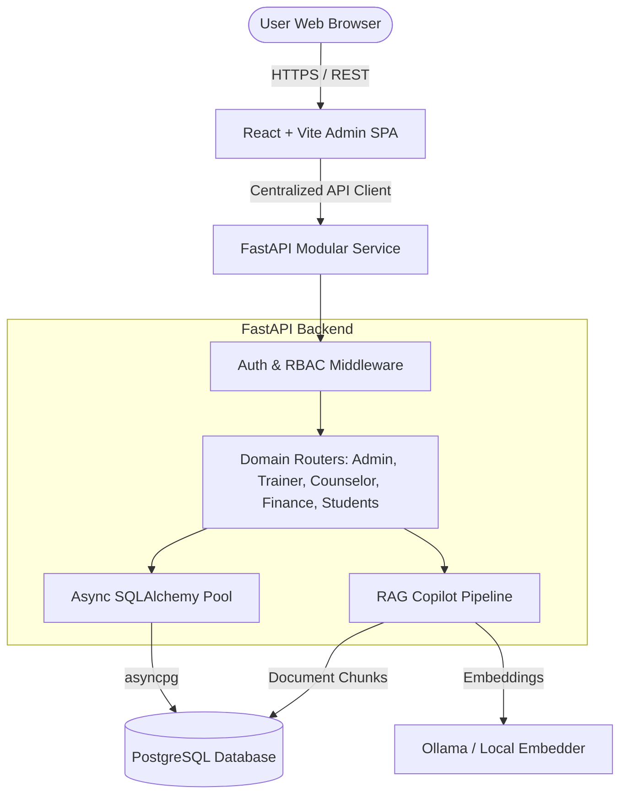

# EduPilot - Institute Operations & Copilot Platform

[](https://www.python.org/)
[](https://fastapi.tiangolo.com/)
[](https://react.dev/)
[](https://www.postgresql.org/)
[](https://tailwindcss.com/)
[]()

EduPilot is an enterprise-grade, AI-augmented management information and operational copilot platform engineered specifically for professional training institutes, vocational academies, and educational organizations.

It seamlessly blends traditional institutional workflows—student lifecycles, admissions pipelines, batch schedules, attendance logs, and financial installment collections—with role-based access control (RBAC), multi-party approval safeguards, and an institutional Retrieval-Augmented Generation (RAG) AI assistant.

---

## Table of Contents
1. [Core Features & Role Ecosystem](#core-features--role-ecosystem)
2. [Technology Stack](#technology-stack)
3. [System Architecture](#system-architecture)
4. [Repository Structure](#repository-structure)
5. [Getting Started (Local Development)](#getting-started-local-development)
6. [Authentication & Credentials](#authentication--credentials)
7. [Testing & Quality Assurance](#testing--quality-assurance)
8. [RAG Knowledge Base & Copilot](#rag-knowledge-base--copilot)
9. [Documentation Suite](#documentation-suite)

---

## Core Features & Role Ecosystem

EduPilot provides specialized, isolated dashboard experiences designed specifically for 5 distinct institutional personas:

```
                  ┌─────────────────────────────────────┐
                  │          Super Admin / Owner        │
                  │ (Full Financial, Approvals, Staff)  │
                  └──────────────────┬──────────────────┘
                                     │
         ┌───────────────────────────┼───────────────────────────┐
         ▼                           ▼                           ▼
┌──────────────────┐       ┌──────────────────┐       ┌──────────────────┐
│ Academic / CRM   │       │ Trainer / Faculty│       │ Finance / Cashier│
│    Counselor     │       │    Dashboard     │       │    Dashboard     │
│ Enquiries, Leads,│       │ Attendance, Batch│       │ Invoicing, Dues, │
│ Follow-ups, Adms │       │ Progress, Rosters│       │ Fee Collections  │
└──────────────────┘       └──────────────────┘       └──────────────────┘
                                     ▲
                                     │ (Student Account Activation)
                           ┌──────────────────┐
                           │ Student Portal   │
                           │ Classes, Modules,│
                           │ Attendance, Fees │
                           └──────────────────┘
```

### 1. Super Admin / Owner Dashboard (`/dashboard/owner`)
- **System KPIs**: Active student count, running batches, monthly financial velocity, pending approval items.
- **Staff Provisioning**: Create, edit, and reset credentials for Counselors, Trainers, Coordinators, and Accountants directly through the UI.
- **Operational Conflicts**: Automatic detection of batch overbooking, room clashes, and scheduling overlaps.
- **Approval Engine**: Dual-control approval workflows for sensitive actions (fee waivers, batch transfers, course cancellations).

### 2. Counselor / CRM Dashboard (`/dashboard/counselor`)
- **Lead Pipeline**: Stage-based lead tracking (`New`, `Contacted`, `Counseling`, `Demo Scheduled`, `Admitted`, `Lost`).
- **Follow-up Tasks**: Scheduled call logs, notes, and task completion reminders.
- **Conversion Workflow**: Seamless transition of leads into registered student records with course allocation.

### 3. Trainer / Faculty Dashboard (`/dashboard/trainer`)
- **Class Schedules**: Today's classes, timings, assigned rooms, and upcoming curriculum sessions.
- **Batch Rosters**: Student rosters for assigned batches with contact details and academic status.
- **One-Click Attendance**: Fast bulk session attendance recording (`Present`, `Absent`, `Late`, `Excused`) with duplicate prevention.
- **Student Progress**: Academic observation logging and module completion tracking.
- **Student Account Invitation**: Generate secure single-use activation tokens allowing enrolled students to activate their student portal accounts.
- **Zero Financial Exposure**: Complete schema-level isolation—trainers cannot view fee balances, installment records, or financial metrics.

### 4. Finance / Accounts Dashboard (`/dashboard/accounts`)
- **Installment Tracking**: Decimal-precise installment schedules with due dates, late flags, and status indicators.
- **Payment Reconciliation**: Record partial and full payments, auto-generate payment receipts, and balance calculation.
- **Collection Velocity & Reports**: Revenue collections, overdue balances, and downloadable CSV financial reports.
- **Fee Waivers**: Submit waiver/discount proposals directly to the Admin approval queue.

### 5. Student Portal (`/dashboard/student`)
- **Academic Progress**: Enrolled courses, assigned batch, module milestones, and daily schedule.
- **Personal Attendance**: Real-time attendance rate visualization and session history.
- **Fee Overview**: Transparent view of personal installment deadlines and receipts.

---

## Technology Stack

| Layer | Technology | Description |
|---|---|---|
| **Frontend Framework** | React 18 + Vite | Blazing fast SPA build and dev server |
| **Frontend Styling** | Tailwind CSS 3.4 | Utility-first, enterprise Slate/Indigo palette |
| **Icons & UI** | Lucide React | Modern, clean vector iconography |
| **Backend Framework** | FastAPI 0.115+ | High-performance asynchronous REST API |
| **Language Runtime** | Python 3.13+ | Fully type-hinted modern Python |
| **ORM & Persistence** | SQLAlchemy 2.0 (Async) | `asyncpg` async connection pooling |
| **Database Migrations** | Alembic | Version-controlled async schema revisions |
| **Database Engine** | PostgreSQL 15+ | Relational persistence with decimal constraints |
| **Vector Store & RAG** | PostgreSQL + NumPy / Ollama | Hybrid vector storage and page-preserving chunking |
| **Document Parsing** | PyMuPDF (fitz) + Markdown | Multi-format institutional knowledge extractor |
| **Authentication** | OAuth2 / JWT + Bcrypt | Secure token authentication with RBAC |

---

## System Architecture



---

## Repository Structure

```
EduPilot/
├── docs/                             # Comprehensive system architecture & guides
│   ├── ARCHITECTURE.md               # Detailed system design & component diagrams
│   ├── PRD.md                        # Product Requirements Document
│   ├── SRS.md                        # Software Requirements Specification
│   ├── SECURITY.md                   # Security, auth model, and RBAC matrix
│   ├── UI_UX.md                      # UI/UX design tokens and component standards
│   ├── PHASES.md                     # Phase roadmap and completion log
│   ├── DEVELOPMENT.md                # Developer onboarding, tooling & workflows
│   ├── RULES.md                      # Strict engineering and coding conventions
│   └── MEMORY.md                     # Architecture Decision Records (ADRs)
├── frontend/                         # Feature-driven React SPA
│   ├── src/
│   │   ├── components/               # Shared atomic UI components (Button, Modal, etc.)
│   │   ├── context/                  # AuthContext and global state providers
│   │   ├── features/                 # Modular domain features
│   │   │   ├── auth/                 # Login & authentication pages
│   │   │   ├── dashboard/            # 5 Role-specific dashboard views
│   │   │   ├── students/             # Student lifecycle views
│   │   │   ├── trainers/             # Trainer views
│   │   │   ├── batches/              # Batch scheduling views
│   │   │   ├── courses/              # Curriculum views
│   │   │   ├── finance/              # Accounting & invoicing views
│   │   │   ├── staff/                # Admin staff management views
│   │   │   └── copilot/              # AI Copilot interactive RAG interface
│   │   ├── services/                 # Central API client
│   │   └── utils/                    # RBAC routing guards & helpers
├── backend/                          # Modular FastAPI API
│   ├── app/
│   │   ├── api/                      # Dependency injectors & shared dependencies
│   │   ├── core/                     # Config (pydantic-settings), security, exceptions
│   │   ├── database/                 # Async sessionmaker, Base, DB lifecycle helpers
│   │   ├── models/                   # SQLAlchemy declarative domain models
│   │   ├── schemas/                  # Pydantic v2 validation schemas
│   │   └── modules/                  # Modular domain routers & services
│   │       ├── auth/                 # JWT auth, login, staff/student activation
│   │       ├── dashboard/            # Role-scoped dashboard metric services
│   │       ├── staff/                # Staff directory & credential management
│   │       ├── trainer/              # Trainer schedules, attendance, student activation
│   │       ├── finance/              # Installments, payments, reports, receipts
│   │       ├── counselor/            # Enquiries, follow-ups, admissions
│   │       └── rag/                  # Document extractor, chunker, vector store, generator
│   ├── migrations/                   # Alembic migration revisions
│   ├── scripts/                      # DB seeding & RAG ingestion utilities
│   └── tests/                        # 40/40 Unit & Integration test suite
├── knowledge_base/                   # Institutional policy and regulation markdown docs
└── docker-compose.yml                # Multi-container orchestration
```

---

## Getting Started (Local Development)

### 1. Prerequisites
- **Python 3.13+** (or 3.11+)
- **Node.js 18+** & npm
- **PostgreSQL 15+** running locally on port `5432`

### 2. Backend Setup
```bash
# Navigate to backend directory
cd backend

# Create virtual environment
python -m venv venv

# Activate virtual environment
# Windows (PowerShell):
.\venv\Scripts\activate
# Linux/macOS:
source venv/bin/activate

# Install dependencies
pip install -r requirements.txt

# Configure environment variables
cp .env.example .env

# Apply database migrations to PostgreSQL
alembic upgrade head

# Seed synthetic development records
python -m scripts.seed_data

# Start FastAPI development server
uvicorn app.main:app --reload --port 8000
```
API Documentation will be live at: `http://localhost:8000/docs`

### 3. Frontend Setup
```bash
# Navigate to frontend directory
cd frontend

# Install dependencies
npm install

# Configure environment variables
cp .env.example .env

# Start Vite dev server
npm run dev
```
Frontend Web Client will be accessible at: `http://localhost:5173`

---

## Authentication & Credentials


### 1. Staff Accounts (Created via Admin Dashboard)
Administrators create Counselor, Trainer, and Finance accounts in **Staff Management** (`/dashboard/owner` → Staff). Initial passwords can be set during creation or reset anytime via the UI.

---

## Testing & Quality Assurance

EduPilot includes an extensive suite of 40 unit and integration tests covering RBAC boundaries, financial isolation, attendance duplicate protection, RAG extraction, and student lifecycles:

```bash
cd backend
.\venv\Scripts\pytest tests -v
```

```
============================= test session starts =============================
tests/integration/test_admin_dashboard.py ......................... PASSED
tests/integration/test_counselor_dashboard.py ..................... PASSED
tests/integration/test_finance_dashboard.py ....................... PASSED
tests/integration/test_trainer_dashboard.py ....................... PASSED
tests/integration/test_staff_credentials_and_admin_env.py ......... PASSED
tests/unit/test_rag_embeddings_and_retrieval.py ................... PASSED
tests/unit/test_rag_extraction_and_chunking.py .................... PASSED
tests/unit/test_rag_models.py ..................................... PASSED

============================= 40 passed in 14.45s =============================
```

---

## RAG Knowledge Base & Copilot

The AI Copilot allows staff to query institutional documents (academic rules, fee policies, grading criteria) with grounded citations.

### Ingesting Documents:
```bash
cd backend
python scripts/ingest_knowledge_base.py
```
This indexes all markdown documents in `knowledge_base/` with page-aware chunking and stores embeddings in PostgreSQL.

---

## Documentation Suite

For deeper technical specifications, refer to the individual documents in the [`docs/`](docs/) directory:

- [**ARCHITECTURE.md**](docs/ARCHITECTURE.md): System architecture, microservice boundaries, database schema, and Mermaid diagrams.
- [**PRD.md**](docs/PRD.md): Product Requirements Document, user personas, problem statements, and feature priorities.
- [**SRS.md**](docs/SRS.md): Software Requirements Specification with explicit functional (`FR-*`) requirements.
- [**SECURITY.md**](docs/SECURITY.md): RBAC authorization matrix, password hashing policies, and zero-leakage security boundaries.
- [**UI_UX.md**](docs/UI_UX.md): Design system tokens, color palettes, responsive states, and component guidelines.
- [**PHASES.md**](docs/PHASES.md): Detailed sprint roadmap and feature delivery milestones.
- [**DEVELOPMENT.md**](docs/DEVELOPMENT.md): Developer guide, database migration commands, and coding conventions.
- [**RULES.md**](docs/RULES.md): Engineering rules, schema separation standards, and pull request checklist.
- [**MEMORY.md**](docs/MEMORY.md): Architecture Decision Records (ADRs) tracking foundational engineering choices.
