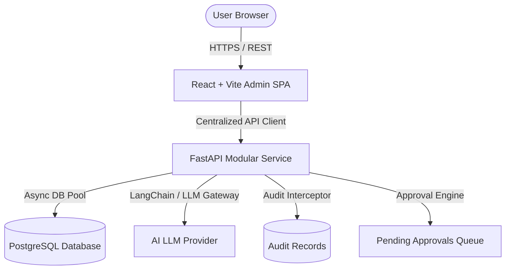

# System Architecture & Technical Specifications

## 1. Architectural Overview
EduPilot follows a clean decoupled client-server architecture:
- **Frontend Presentation Layer**: Single Page Application built on React + Vite, styled with Tailwind CSS, utilizing a feature-first folder organization and centralized API client.
- **Backend Application Layer**: Modular FastAPI microservice architecture with separated layers:
  - Routing / Endpoints (`api/`)
  - Domain Business Logic (`modules/` & `services/`)
  - Data Access & Persistence (`repositories/` & `database/`)
  - Schemas & Validation (`schemas/` with Pydantic v2)
  - Core Infrastructure (`core/` security, configs, custom exceptions)
- **Data Persistence Layer**: PostgreSQL relational database with async connection pooling.
- **AI Integration Layer**: Modular LLM adapter with strict tool-calling schemas and human-in-the-loop approval interception.



## 2. Frontend Architecture
- **State Management**: React local state, contextual state for Authentication/Session, and server-cache pattern via custom hooks.
- **Routing**: React Router DOM with route-level protected guards (`ProtectedLayout`).
- **Design System**: Atomic UI components (`Button`, `Input`, `Modal`, `Table`, `Badge`, `Loader`) composed into common layout blocks (`PageHeader`, `EmptyState`, `ErrorMessage`, `ConfirmDialog`).
- **Feature Structure**:
  ```
  features/{feature_name}/
  ├── pages/        # Route entry points
  ├── components/   # Feature-specific subcomponents
  └── {name}Api.js  # Dedicated HTTP client calls for this feature
  ```

## 3. Backend Architecture
- **Dependency Injection**: FastAPI `Depends()` for database session management, token decoding, and role evaluation.
- **Repository Pattern**: Clean separation between SQLAlchemy queries and business domain rules.
- **Exception Handling**: Global exception handlers transforming domain exceptions into uniform RFC-7807 JSON error responses.

## 4. Security Architecture
- RBAC validation at the FastAPI route dependency level (`require_role(...)`).
- JWT tokens with short expiry (e.g. 60 minutes) and secure HTTP headers.
- CORS policy with strict origin whitelisting.
