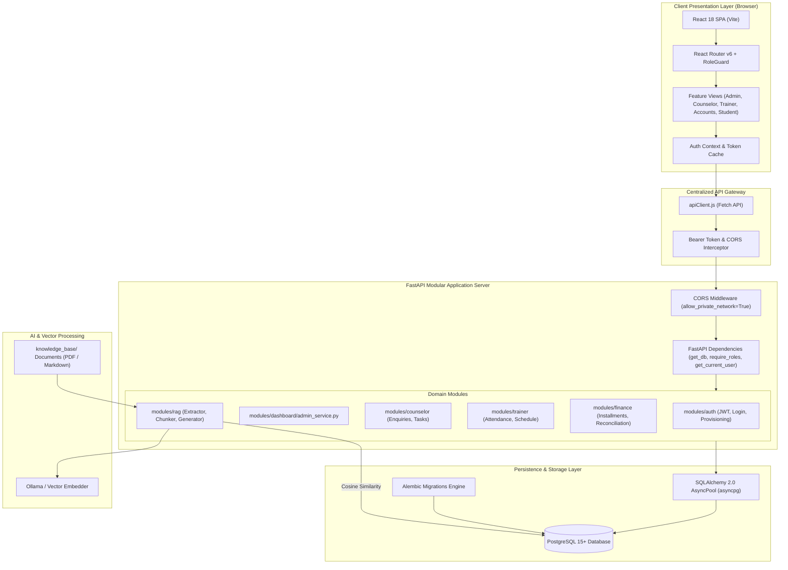
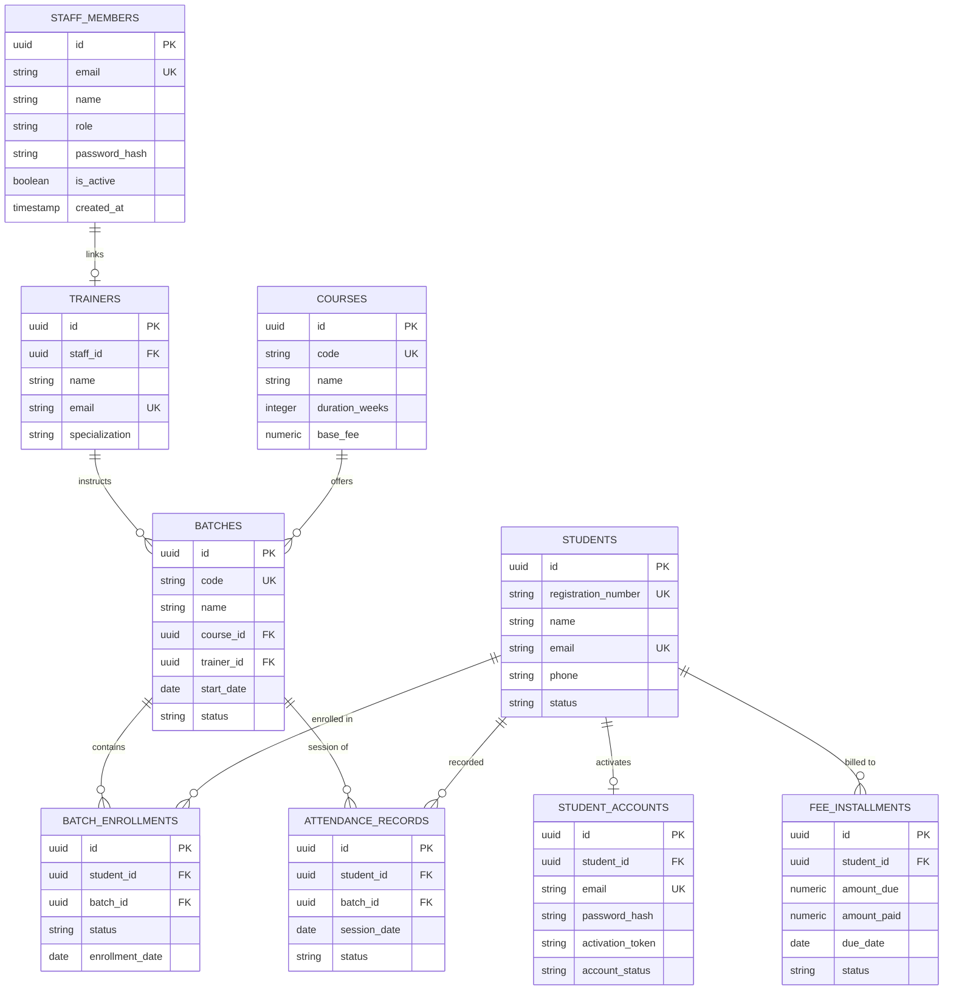

# System Architecture & Technical Specifications

EduPilot is architected as an asynchronous, decoupled client-server platform designed for high-concurrency educational operations. It separates core domain logic, persistence, authorization, and presentation layers into strict modular boundaries.

---

## 1. Architectural Overview & Component Diagram

The platform comprises five primary operational subsystems:
1. **Frontend Presentation Client (React 18 + Vite)**: Single Page Application with feature-sliced folders, local optimistic UI updates, and centralized API transport.
2. **Modular REST API (FastAPI)**: Asynchronous controller layer with dependency injection, Pydantic v2 validation, and role-based access filtering.
3. **Relational Data Layer (PostgreSQL + SQLAlchemy 2.0)**: Async connection pooling (`asyncpg`), ACID transaction guarantees, decimal-safe financial types, and composite uniqueness constraints.
4. **Institutional RAG Assistant**: Document ingestion pipeline, page-preserving sliding chunker, vector store, and grounded generation engine.
5. **Security & RBAC Enforcement**: Route-level dependency guards, cryptographic token verification, and schema-level data omission.



---

## 2. Frontend Architecture (React + Vite)

### 2.1 Feature-Sliced Organization
The frontend codebase avoids cross-boundary dependencies by encapsulating all domain logic inside dedicated feature modules:

```
frontend/src/
├── components/               # Global agnostic UI components
│   ├── ui/                   # Atomic primitives: Button, Input, Modal, Table, Badge, Loader
│   └── common/               # Layout blocks: PageHeader, EmptyState, ErrorBanner, ConfirmDialog
├── context/                  # Global providers (AuthContext, ToastContext)
├── features/                 # Domain-specific feature modules
│   ├── auth/                 # LoginPage, activation components, auth services
│   ├── dashboard/            # 5 Role-scoped dashboard implementations
│   │   ├── components/       # Metric cards, schedule rosters, conflict lists
│   │   │   ├── admin/
│   │   │   ├── counselor/
│   │   │   ├── trainer/
│   │   │   ├── accounts/
│   │   │   └── student/
│   │   └── pages/            # Role-specific dashboard pages
│   ├── students/             # Student directory, profile modals, enrollment actions
│   ├── trainers/             # Faculty directory, trainer assignment
│   ├── batches/              # Batch scheduling, classroom allocation, course links
│   ├── courses/              # Curriculum catalog and duration configuration
│   ├── finance/              # Installment ledger, payment modal, invoice receipt generator
│   ├── staff/                # Admin staff provisioning, role editor, password reset modal
│   └── copilot/              # Interactive AI chat interface with citation chips
├── layouts/                  # App shells (DashboardLayout, Sidebar, Navbar)
├── services/                 # Centralized apiClient with token injection & error parsing
└── utils/                    # Role constants, routing maps, formatting helpers (rbac.js)
```

### 2.2 Navigation & Route Guards (`RoleGuard.jsx`)
Access to views is guarded at the route level using `RoleGuard`:
- If an unauthenticated user attempts to visit a protected route, they are seamlessly redirected to `/login`.
- If an authenticated user attempts to visit a dashboard outside their role permissions (e.g. Trainer navigating to `/dashboard/owner`), they are automatically rerouted to their own role's designated dashboard without breaking application state.
- Roles and navigation items are configured in a single source of truth: `src/utils/rbac.js`.

---

## 3. Backend Architecture (FastAPI & Domain Services)

### 3.1 Modular Clean Architecture
The backend is structured into distinct, self-contained domain modules under `backend/app/modules/`. Each module maintains its own routes, business logic services, and data schemas:

```
backend/app/
├── api/                      # Cross-cutting dependencies (get_current_user, require_roles)
├── core/                     # Central application configuration & security
│   ├── config.py             # Pydantic Settings reading .env (CORS, JWT secret, DB URLs)
│   ├── security.py           # Bcrypt password hashing and JWT encoding/decoding
│   └── exceptions.py         # Custom domain exceptions (Forbidden, NotFound, InvalidCredentials)
├── database/                 # Asynchronous database connection lifecycle
│   ├── base.py               # DeclarativeBase, TimestampMixin, UUIDPrimaryKeyMixin
│   ├── session.py            # create_async_engine with connection pooling
│   └── utils.py              # Health check probes, connection verification
├── models/                   # SQLAlchemy declarative domain models
│   ├── institute.py          # Students, Batches, Courses, Trainers, Staff, Attendance, Fees
│   └── rag.py                # KnowledgeDocument, DocumentChunk (Vector store)
├── schemas/                  # Pydantic v2 validation contracts
│   ├── institute.py          # Create, Update, Response schemas for all models
│   └── rag.py                # Query, citation, and chunking schemas
└── modules/                  # Modular domain routers & services
    ├── auth/                 # Login, session verification, student invitation activation
    ├── dashboard/            # Role-specific analytics calculation services
    ├── staff/                # Staff directory management & credential provisioning
    ├── trainer/              # Trainer rosters, attendance recording, student account tokens
    ├── finance/              # Payment ledger, receipt generation, CSV exports
    ├── counselor/            # Enquiries, follow-up logs, lead-to-student conversions
    └── rag/                  # Multi-format document parser, chunker, vector store
```

### 3.2 Dependency Injection Pattern
FastAPI's dependency injection system is leveraged across every endpoint:
```python
@router.post("/attendance")
async def record_attendance(
    payload: AttendanceRecordCreate,
    db: AsyncSession = Depends(get_db),
    current_user: TokenData = Depends(require_roles(["trainer", "super_admin", "admin"])),
):
    ...
```
This guarantees:
1. **Isolated DB Sessions**: Each HTTP request receives a dedicated, auto-closing async transaction.
2. **Guaranteed Role Verification**: Requests are halted before reaching the controller if token claims do not meet requirements.

---

## 4. Database Schema & Relational Model Design

The database schema utilizes strict relational constraints, composite indices, foreign keys, and decimal fields:



### Key Relational Constraints:
- **Composite Unique Attendance**: `uq_student_batch_session_date` on `(student_id, batch_id, session_date)` prevents duplicate attendance entries for the same student on the same day.
- **Financial Decimal Types**: `Numeric(12, 2)` utilized for all monetary fields (`base_fee`, `amount_due`, `amount_paid`), avoiding floating point inaccuracies.
- **Check Constraints**: `amount_due >= 0`, `amount_paid >= 0`, and `amount_paid <= amount_due` enforced at the database level.

---

## 5. Retrieval-Augmented Generation (RAG) Architecture

EduPilot features an integrated institutional Copilot capable of extracting and citing administrative regulations and policies:

```
[Institutional Markdown / PDF Files]
                 │
                 ▼
       ┌──────────────────┐
       │ DocumentExtractor│ (PyMuPDF & Markdown page-marker parser)
       └─────────┬────────┘
                 │ Extracted Pages & Clean Text
                 ▼
       ┌──────────────────┐
       │ DocumentChunker  │ (Page-Preserving Sliding Window Overlap)
       └─────────┬────────┘
                 │ Chunks with Source Page Metadata
                 ▼
       ┌──────────────────┐
       │ EmbeddingService │ (Ollama qwen3-embedding:4b / Offline Deterministic)
       └─────────┬────────┘
                 │ Vector Embeddings
                 ▼
       ┌──────────────────┐
       │   VectorStore    │ (PostgreSQL JSON Vectors & NumPy Cosine Similarity)
       └─────────┬────────┘
                 │ Top-K Relevant Excerpts (Filtered by Role)
                 ▼
       ┌────────────────────────┐
       │ GroundedAnswerGenerator│ (Constrained Prompt Synthesis with Strict Citations)
       └────────────────────────┘
```

- **Strict Source Binding**: Every chunk retains its originating physical page number.
- **Verifiable Citations**: Synthesized answers include explicit source references: `[Document Title, Page X]`.
- **Hallucination Guard**: When document similarity is below threshold or evidence is missing, the generator explicitly returns: *"The available institutional documents do not contain sufficient information to answer this question."*
